<div align="center">



**Independent Nuclear Systems Researcher · Full-Stack Developer · Professional Wanderer of Ideas**

-39ff14?style=for-the-badge&labelColor=0b0d17)


</div>


## 🛰️ TRANSMISSION RECEIVED

```text
   .       *        .    ☢    .         *       .
        .      🚀 ~~~~>        .    *
  *        .            .          .       .
      ____________________________________
     |  NEUTRON FLUX:        ████████░░  |
     |  CODE QUALITY:        █████████░  |
     |  SLEEP:               ██░░░░░░░░  |
     |  CURIOSITY:           ██████████  |
     |____________________________________|
```

Hey, I'm **Rudra**. I study nuclear systems, build things on the web, and write about whatever my wandering mind drifts into. If it involves splitting atoms, launching things, or shipping clean code, I'm probably already in the blast radius.


## ⚛️ RESEARCH BAY

I run **Monte Carlo neutron transport** simulations and model things with **IRT / ML** approaches. Think of it as sending a few billion tiny particles through a reactor and seeing where they end up.

| 🔬 System | 🧪 What I do with it |
|-----------|---------------------|
| **OpenMC** | Monte Carlo particle transport for nuclear systems |
| **Scientific Python** | Number crunching, analysis, and plots |
| **IRT / ML modeling** | Turning data into predictions that (mostly) behave |


## 🛠️ ENGINEERING DECK

```text
┌─────────────────────────────────────────────┐
│  FRONTEND   →  Jekyll · Markdown · JS/CSS/HTML │
│  BACKEND    →  Python · Flask                  │
│  SCIENCE    →  OpenMC · Scientific Computing   │
│  PHILOSOPHY →  Plan it. Log it. Test it.       │
└─────────────────────────────────────────────┘
```


## 🌌 ACTIVE MISSIONS

- 🎯 **CAC-SATPT**: a full-stack adaptive SAT practice test generator built for the Congressional App Challenge
- 🛡️ **Elder Scam Checker**: a scam-detection web app that helps seniors spot fraud before it gets them
- ✍️ **Inside a Wandering Mind**: my small, non-monetized society and tech blog

> 🔧 *Add repo links here once you're ready to put these on the launchpad.*


## 📡 DEEP SPACE COMMS

| Channel | Link |
|---------|------|
| 📝 **Blog** | [inside-a-wandering-mind.com](https://inside-a-wandering-mind.com) |
| 🐙 **GitHub** | [@RudraBJoshi](https://github.com/RudraBJoshi) |


## 🧭 MISSION PROTOCOLS

```text
 1. NO LAUNCH WITHOUT A PLAN.      (Every operation gets a rigid plan.)
 2. KEEP THE FLIGHT LOG.           (Running log, always.)
 3. TEST EVERYTHING.               (Thoroughly. Before shipping.)
 4. STAY CURIOUS.                  (The universe is big and weird.)
```

---

<div align="center">

### 🌠 *"We are a way for the cosmos to know itself, and also to debug itself."*


**`// END TRANSMISSION //`**

</div>
